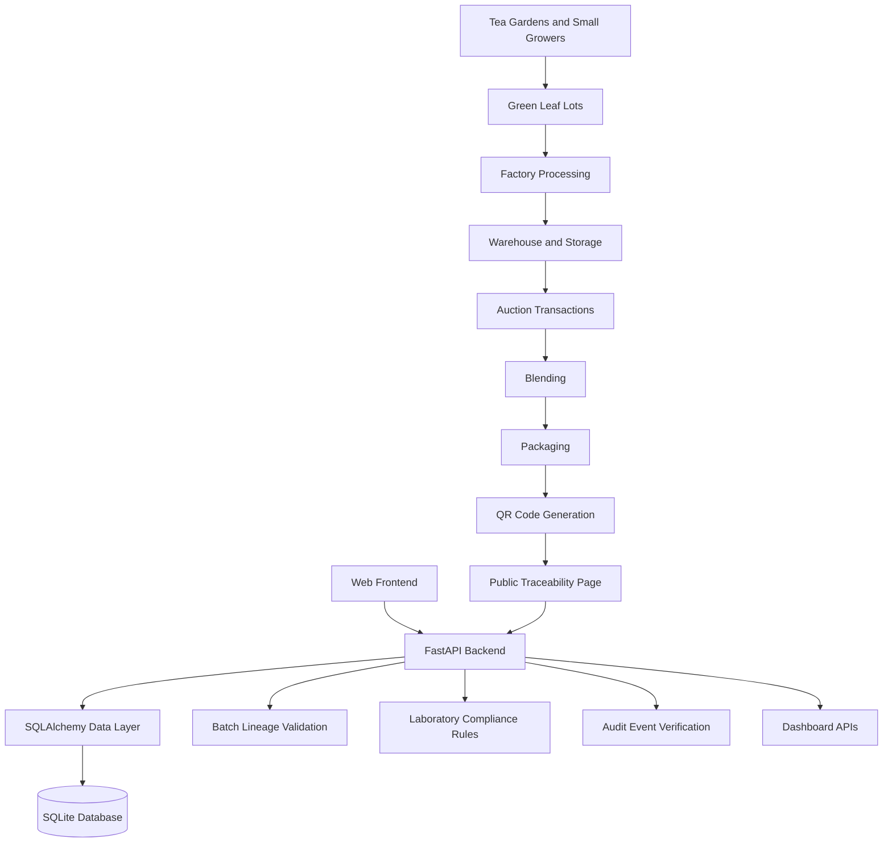

# 🍃 Assam TeaTrace
### Digital Traceability for Assam's Tea Supply Chain

**Assam TeaTrace** is a digital tea supply-chain traceability platform designed to track tea from its origin at tea gardens through processing, warehousing, auction, blending, and packaging. It provides QR-based product verification, batch lineage tracking, laboratory compliance evaluation, and tamper-evident audit logging.

The project explores how digital technologies can improve transparency, traceability, and trust across Assam's tea ecosystem.

**Project Status:** Working prototype under development  
**Repository:** [github.com/zamanfz/Assam-Teatrace](https://github.com/zamanfz/Assam-Teatrace)

---

## 📌 Problem Statement

Assam's tea supply chain involves multiple stakeholders, including tea gardens, small growers, factories, warehouses, auction participants, blenders, and retailers.

Tracking the origin and movement of tea across these stages can be challenging when records are fragmented across different systems and organisations.

Assam TeaTrace aims to address these challenges through a unified digital traceability platform that connects supply-chain events and makes relevant product history accessible to authorised stakeholders and consumers.

## 💡 Proposed Solution

The platform maintains digital records of tea batches and their relationships throughout the supply chain.

Each stage records relevant information about the batch, its movement, and its relationship to preceding batches. Consumers can use a QR code to access a public traceability page containing product provenance and compliance information.

The system is built as a modular web application using Python, FastAPI, SQLAlchemy, and a lightweight JavaScript frontend.

## ✨ Key Features

### 1. End-to-End Supply-Chain Traceability
Tracks tea through the following stages:

- Tea garden and green leaf procurement
- Factory processing and manufacturing
- Warehousing and storage
- Auction transactions
- Blending and packaging

### 2. Batch Lineage Tracking
- Assigns identifiers to batches and supply-chain entities.
- Records relationships between source and destination batches.
- Supports traceability across processing, splitting, and blending workflows.
- Maintains links between packaged tea and its upstream sources.

### 3. QR-Based Product Verification
- Associates QR codes with packaged tea batches.
- Provides a public product traceability endpoint.
- Presents provenance information through a consumer-facing interface.
- Displays relevant compliance status alongside traceability information.

### 4. Laboratory Compliance Evaluation
- Records laboratory test information associated with tea batches.
- Evaluates test results against configured compliance rules.
- Supports PASS, FAIL, and NOT_EVALUATED outcomes.
- Provides compliance information through the traceability workflow.

*Compliance results depend on the configured rules and recorded test data. They do not independently certify a product's regulatory compliance.*

### 5. Tamper-Evident Audit Logging
- Records audit events.
- Uses SHA-256 hash chaining to help detect changes to recorded audit history.
- Includes an audit verification endpoint.

The current implementation provides tamper-evidence checks; it is not a blockchain network or an immutable external ledger.

### 6. Quantity and Lineage Validation
- Implements validation logic for batch quantities and relationships.
- Checks consistency between packaging quantities and upstream production records.
- Evaluates relationships between blends, auction lots, warehouses, factories, and green leaf lots.

**Development note:** Package lineage validation still requires further verification. The project should not be considered fully validated until the affected endpoint and its underlying quantity checks pass.

### 7. Dashboard and Traceability Interface
- Provides dashboard endpoints for summary information.
- Includes a browser-based dashboard.
- Includes a consumer-facing traceability page.
- Separates public traceability information from internal laboratory details.

---

## 🏗️ System Architecture



### Technology Stack

| Component | Technology |
|---|---|
| Backend language | Python |
| API framework | FastAPI |
| Database ORM | SQLAlchemy |
| Database | SQLite |
| Database migrations | Alembic |
| Data validation | Pydantic |
| Frontend | HTML, CSS, JavaScript |
| Product verification | QR codes |
| Audit integrity | SHA-256 hash chaining |
| Testing | Pytest |
| API documentation | FastAPI / OpenAPI |

---

## 📂 Project Structure

```text
assam-teatrace/
│
├── backend/
│   └── app/
│       ├── main.py
│       ├── database/
│       ├── models/
│       ├── routers/
│       ├── services/
│       └── ...
│
├── frontend/
│   ├── index.html
│   ├── app.js
│   ├── style.css
│   ├── dashboard.html
│   ├── dashboard.js
│   ├── trace.html
│   └── trace.js
│
├── data/
│   └── ...
│
├── docs/
│   └── ...
│
├── alembic.ini
├── requirements.txt
├── .gitignore
└── README.md
```

*The tree is a high-level overview; some implementation files have been omitted for readability.*

---

## ⚙️ Getting Started

### Prerequisites

Install the following:

- Python 3.10 or a compatible version supported by the project's dependencies
- Git
- Visual Studio Code or another code editor
- A modern web browser

### 1. Clone the repository

```bash
git clone https://github.com/zamanfz/Assam-Teatrace.git
cd Assam-Teatrace
```

### 2. Create a virtual environment

**Windows PowerShell:**

```powershell
python -m venv venv
.\venv\Scripts\Activate.ps1
```

If PowerShell prevents activation, you can use Command Prompt instead:

```bat
venv\Scripts\activate.bat
```

### 3. Install dependencies

```bash
python -m pip install --upgrade pip
pip install -r requirements.txt
```

### 4. Start the backend

From the project root, run:

```bash
python -m uvicorn backend.app.main:app --reload --port 8000
```

The backend should be available at:

- **API base:** `http://127.0.0.1:8000`
- **Interactive API documentation:** `http://127.0.0.1:8000/docs`
- **OpenAPI schema:** `http://127.0.0.1:8000/openapi.json`

The application creates database tables through its configured SQLAlchemy setup. Database migrations, if needed, should be handled according to the project's Alembic configuration.

### 5. Open the frontend

Open the relevant HTML files inside the `frontend/` directory in your browser.

For a more consistent local development setup, you can serve the frontend from a local HTTP server:

```bash
python -m http.server 5500 --directory frontend
```

Then open:

`http://127.0.0.1:5500/`

**Note:** The frontend's API configuration must point to the running backend. Some browser-based functionality may require the frontend to be served over HTTP rather than opened directly as a file.

---

## 🔌 API Overview

The backend exposes REST endpoints for different parts of the traceability workflow.

| Area | Purpose |
|---|---|
| Health | Basic application health check |
| Tea and batches | Manage supply-chain entities and batch records |
| Lineage | Validate and inspect relationships between batches |
| QR codes | Associate QR identifiers with packaged products |
| Compliance | Evaluate laboratory results against configured rules |
| Audit verification | Check the integrity of recorded audit events |
| Dashboard | Provide supply-chain summary information |

The precise endpoints, request schemas, and response formats are available through the interactive API documentation after starting the backend:

`http://127.0.0.1:8000/docs`

### Example: Health Check

```http
GET /health
```

### Example: Public Product Trace

```http
GET /api/trace/TEA-PKG-0002
```

The public trace endpoint has been tested with the project's demo data. Check the API documentation for the exact route and response schema if the implementation changes.

---

## 🧪 Testing

The project uses Pytest for automated testing.

Install the dependencies and run:

```bash
python -m pytest -v
```

Tests should be run against the current code and a suitable test database.

Previously reported tests covered parts of the traceability and compliance workflow. Package quantity and lineage validation still require additional verification.

Do not interpret a passing test suite as proof that every endpoint, security control, integration, or regulatory requirement has been validated.

---

## 🔐 Security and Data Privacy

Security and privacy are important considerations for a traceability platform involving multiple supply-chain stakeholders.

Current and planned considerations include:

- Excluding local database files and environment secrets from version control.
- Separating public consumer information from internal records.
- Recording audit events and verifying hash-chain integrity.
- Introducing and validating role-based permissions.
- Protecting sensitive commercial information.
- Validating input data and supply-chain relationships.
- Using HTTPS and secure configuration for deployment.

The current prototype should not be assumed to provide production-grade authentication, authorisation, or security controls without further verification and testing.

**Never commit AWS credentials, API keys, passwords, private keys, or confidential production data to the repository.**

---

## 🔗 Interoperability and Integration

The platform is designed around API-based communication and structured supply-chain records.

Potential integration targets include:

- Tea Board of India systems
- Guwahati Tea Auction Centre (GTAC)
- Laboratory information systems
- Factory and warehouse management systems
- Downstream packaging and distribution systems

Actual integration with these external systems has **not been demonstrated** in the current prototype.

Future integration work would require approved access, documented API specifications, compatible data formats, identity and permission controls, and validation against the requirements of each participating organisation.

---

## 📊 Demo Data and Limitations

The repository is a prototype intended to demonstrate the technical approach to digital tea traceability.

Important limitations:

- The current demonstration uses synthetic or locally maintained sample records.
- Recorded provenance does not independently prove that a real-world transaction occurred.
- Laboratory results and compliance outcomes depend on the supplied test records and configured rules.
- Live Tea Board and GTAC integrations have not been established.
- Production authentication and role-based access controls require further verification.
- Offline operation, large-scale performance, and deployment costs have not been validated.
- Package lineage and quantity validation require additional testing.

These limitations define the difference between the current prototype and a production-ready traceability platform.

---

## 🚀 Future Enhancements

Potential next steps include:

- Integrating with approved institutional and auction APIs.
- Implementing robust role-based access control.
- Supporting offline data capture and synchronisation for low-connectivity areas.
- Strengthening batch quantity and chain-of-custody validation.
- Adding digital certificates and verifiable origin records.
- Improving laboratory data exchange and regulatory rule management.
- Adding monitoring, logging, backups, and deployment automation.
- Testing performance with larger volumes of batches and transactions.
- Conducting usability testing with tea growers and supply-chain stakeholders.
- Deploying the application with HTTPS and secure production configuration.

---

## 🎯 Intended Impact

Assam TeaTrace explores how a digital traceability platform could help:

- Improve visibility into the movement of tea.
- Link packaged products to upstream batch records.
- Support more accessible product-origin verification.
- Make laboratory compliance information easier to retrieve.
- Improve the detection of inconsistencies in recorded supply-chain events.
- Establish a foundation for interoperability across the tea ecosystem.

These are intended benefits; their real-world impact would need to be demonstrated through field testing and stakeholder validation.

---

## 👨‍💻 Author

**Fahim Zaman**  
Computer Science and Engineering  
Dibrugarh University Institute of Engineering and Technology (DUIET)

GitHub: [@zamanfz](https://github.com/zamanfz)

---

## 📄 License

No open-source license has been specified yet. Until a license is added, the repository should not be assumed to grant permission to reuse, modify, or redistribute the code.

---

### Project Summary

Assam TeaTrace is a Python-based tea supply-chain traceability prototype combining REST APIs, batch lineage, QR-based product verification, laboratory compliance evaluation, and tamper-evident audit logging. It is a foundation for further validation, security improvements, and integration with Assam's existing tea ecosystem.